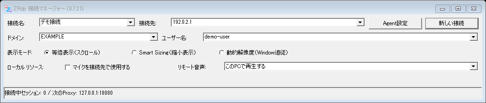
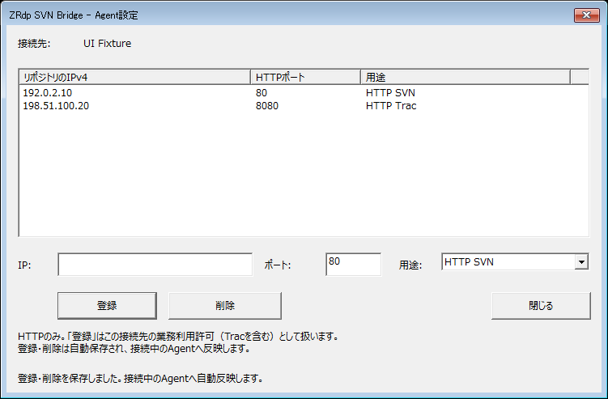

# ZRdp SVN Bridge

<p align="center">
  
</p>

Windows標準のRDP画面操作と、HTTP方式のSVN／Tracへのアクセスを、一つのRDP接続で扱うWindows x64アプリです。
開発PCのClientと、接続先のRDPユーザーセッション内で動くAgentを組み合わせます。
既存のリポジトリURLを変更せず、対象のSVN／Tracクライアントだけをlocalhost Proxyへ向ける構成です。

> [!IMPORTANT]
> 許可済みのRDP接続とHTTP接続だけを使用します。Zscaler、Firewall、GPO、RDP認証、OSのProxy設定を変更・回避しません。
> ZRdpの名称はZscalerとの提携・認定・公式製品であることを意味しません。

現在は公開準備中の開発版です。ソースの製品Versionは `0.7.20.0` ですが、過去の同Versionの社内配布物とは内容が異なります。
この変更に対する新しいReleaseはまだ作成していません。リポジトリはPrivateのままです。

## できること

- 接続マネージャーから最大16件のRDP接続を、それぞれ独立したウィンドウで利用
- 等倍表示、Smart Sizing、動的解像度、Microsoftの接続バーによる全画面操作
- 接続ごとのAgent設定と、認証後のAgent自動配置・更新・起動
- Agentとの疎通が途絶えたときの有限回の自動復旧、設定変更時の再起動
- RDPセッションごとのlocalhost HTTP Proxyと、最大8本のHTTPストリームの多重化
- HTTP/1.1、SVNのWebDAV／DeltaV、承認済みTracのHTTP通信の中継
- Client／Agentを同じVersionのセットとして取得する、利用者同意付きの更新

AgentはWindowsサービスではなく、通常ユーザーのタスクトレイアプリです。
追加の受信ポート、管理者権限、ドライバー、VPN、仮想NICは不要です。
実際のSVN／Mylyn環境との互換性・性能は、利用環境ごとに確認してください。

## 仕組み

```text
開発PC
  SVN／Mylyn Trac
       │ HTTP Proxy: 127.0.0.1:<セッション専用ポート>
       ▼
  ZRdpSvnBridge.exe ── Windows Remote Desktop ActiveX Control
       │
       │ 既存RDP接続内のStatic Virtual Channel「ESVNBRG」
       ▼
接続先PCのRDPユーザーセッション
  ZRdpSvnAgent.exe + agent.ini
       │ IPv4:ポートがallowlistに完全一致するHTTP接続だけ
       ▼
  許可済みHTTP SVN／明示承認済みHTTP Trac
```

Clientは開発PCで実行します。AgentはClientが認証したRDPユーザーセッション内で実行します。
Agentから開発PCへの逆方向接続や、任意の通信先への汎用転送は行いません。
設計の詳細は [アーキテクチャ](docs/architecture.md) と [通信プロトコル](docs/protocol.md) を参照してください。

## はじめて使う

### 1. 事前条件と配置

- 両PCがWindows x64で、開発PCにWindows標準のRemote Desktop ActiveX Controlがあること
- 接続先へのRDP接続、接続先でのEXE実行、必要なHTTP endpointの利用が組織から許可されていること
- 自動配置に使うRDPの専用ドライブ転送・クリップボード転送が許可されていること
- 対象のHTTPサーバーを **IPv4アドレスとポート** で指定できること

同じVersionの二つのEXEを、開発PCの同じ書込み可能フォルダへ置きます。インストーラーは不要です。

```text
ZRdp/
├─ ZRdpSvnBridge.exe  ← 起動するClient
└─ ZRdpSvnAgent.exe   ← Clientが接続先へ配置するAgent
```

接続先への配置先は、そのユーザーの `%LOCALAPPDATA%\ZRdp` に固定です。
通常は接続先で手動コピーや手動起動をする必要はありません。
自前の未署名ビルドも起動・配置できますが、Versionや製品情報の一致、安全なファイル配置の検証は省略しません。
信頼できる配布元を使い、Windowsや組織の実行制限に従ってください。

### 2. 接続情報を入力する

`ZRdpSvnBridge.exe` を起動し、接続先、必要なドメイン、ユーザー名を入力します。接続名は任意です。
パスワードはZRdpに保存せず、Microsoftの認証画面で扱います。
認証済みの接続履歴はWindowsユーザー単位でDPAPI暗号化して保存します。



画像は架空の情報を使用したUIテスト画面です。接続は行っていません。WindowsのテーマやDPIで外観は変わります。

### 3. この接続のAgent設定を登録する

接続マネージャーの **「Agent設定」** を開き、許可されたHTTPサーバーのIP、ポート、用途を入力して「登録」を押します。
削除する場合は一覧から選んで「削除」を押します。登録・削除は自動保存され、保存ボタンはありません。



この画面も架空の設定です。`192.0.2.10`、`198.51.100.20` は文書用アドレスなので、実運用には使わないでください。

- 保存単位は **接続先＋ドメイン＋ユーザー名** です。接続名だけの変更では別設定になりません。
- 接続先を切り替えると、その接続に登録されている宛先だけを表示します。未設定なら空一覧です。
- 「登録」は、そのHTTP接続先の業務利用を許可する操作です。Tracも含め、事前に権限を確認してください。
- **一件も登録されていない接続ではAgentを起動・再起動しません。** RDP画面は利用できます。
- 設定は `%LOCALAPPDATA%\ZRdpSvnBridge\agent-settings.bin` へDPAPI暗号化して保存します。

入力範囲と保存仕様は [接続別Agent設定](docs/agent-settings.md) を参照してください。

### 4. RDP接続後は自動起動を待つ

「新しい接続」を押して、Microsoftの認証画面で接続します。
認証が完了し、RDP画面が前面かつ入力操作が落ち着いていると、ClientがAgentを配置・更新して起動します。
ZRdp独自の起動確認ダイアログや、起動ボタンはありません。

自動起動では固定の `Win+R`、貼り付け、実行をキーボード入力として送ります。
接続先の「ファイル名を指定して実行」が一時的に見える場合があります。自動処理中は入力を避けてください。
Windowsの警告や組織の実行制限は自動承認・回避しません。
前面状態や入力先の確認に失敗した場合、処理を停止してRDP接続を維持します。
ただし、直前確認後のウィンドウ切替との競合により、ローカルの別画面へ貼り付け・Enterが届いて
誤実行するリスクは完全には排除できません。起動処理はクリップボードを固定文字列へ置き換え、元の内容は復元しません。

セッションのタイトルに `Agent:接続済み` と `Proxy:利用可 127.0.0.1:<port>` が表示されてからSVN／Tracを利用します。
Agentの応答や最新設定の適用確認前に、Proxyを利用可能にしません。

### 5. SVN／Tracの対象設定だけをProxyへ向ける

既存の `http://<IPv4>[:port]/...` のURLは変更しません。
JavaHLが使用するSubversionの `servers` 設定、またはMylynのリポジトリ固有Proxy設定で、対象だけに次を指定します。

| 項目 | 値 |
|---|---|
| Proxyホスト | `127.0.0.1` |
| Proxyポート | 対象RDPセッションのタイトルに表示されたポート |
| Proxy認証 | 使用しない |
| SVN／Trac認証 | 従来のクライアントと実サーバーの間で扱う |

既定の最初の接続は `18080`、追加接続は空きスロットに `18081`、`18082`…を割り当てます。
別アプリがそのポートを使用中でも、別経路への自動切替はしません。
具体的な設定例は [利用手順のSVN／Trac設定](docs/user-guide.md#8-javahl-svnのproxy設定) を参照してください。

## 日常の操作

一度Agent設定を登録した接続は、以後RDP接続するだけです。
接続中にAgentの疎通が途絶えた場合も、Clientが回数・間隔を制限して復旧を試みます。無限には再起動しません。

Agentの状態と終了操作は、接続先のタスクトレイアイコンから確認できます。


> [!NOTE]
> Agentをトレイから終了しても、RDP接続が続き、登録済み設定がある場合は自動復旧の対象になります。
> 意図して停止する場合は、そのRDP接続を閉じるか、Agent設定の登録をすべて削除してください。

接続中の設定変更はAgentを協調停止し、新設定で再起動します。
処理中のHTTPストリームは終了するので、SVN／Trac操作が終わってから変更してください。
既存のAgent／INIを更新する際は接続先でバックアップを保持します。ロックや安全性の検証に失敗したファイルは強制上書きしません。

### 表示モードと全画面

| モード | 接続先の解像度への影響 |
|---|---|
| 等倍表示（スクロール） | 接続開始時の解像度を維持。既定 |
| Smart Sizing（縮小表示） | 解像度を維持し、Client側の描画だけを拡縮 |
| 動的解像度（Window追従） | ウィンドウに合わせて接続先の解像度を変更 |

接続前にマネージャーで選び、接続後もセッション上部で切り替えられます。
全画面ボタンまたは `Ctrl+Alt+Break` で全画面に切り替えます。
復帰・最小化はMicrosoftの接続バーを使用します。全画面中は独自の操作欄を重ねません。
マイク転送とリモート音声は接続前に指定し、接続中のセッションへ途中変更しません。

## 更新

更新機能は実装済みです。Client起動時と、その後24時間ごとにGitHub Releaseを自動確認します。
更新の取得・適用には利用者の同意が必要で、二つのEXEを同Versionのセットで取得します。
設定画面とすべてのRDPセッションを閉じ、設定保存が完了してから適用し、Clientを再起動します。
接続先のAgentは、次のRDP接続時に登録済み設定に基づいて更新します。

**自動更新では、実行中と候補のClient／Agentの有効な署名、同一署名者、Version、ハッシュ等を検証します。**
未署名の自前ビルドの起動は許可しますが、この自動更新経路は使用できません。自前ビルドは両EXEを手動で揃えて更新してください。

現時点の更新先はPrivateリポジトリのため、匿名の自動確認ではReleaseを取得できません。
認証トークンの保存・送信は実装していません。新しい公開Releaseも未作成です。
起動・自動管理の実機受入、署名、Version更新と配布物の確認を経て、後日リリースします。

外部への更新確認を行わない場合は、Client EXEの横に次の `client.ini` を置きます。
設定がない場合は更新確認が有効です。

```ini
[update]
enabled=false
```

Proxyの基準ポートを変更する場合は同じファイルに `[proxy]` と `port` を指定できます。
詳細と配布用manifestの作成方法は [Client／Agentセット更新](docs/client-updates.md) を参照してください。

## 制限と安全性

- 対象はHTTPのIPv4 literalです。HTTPS、hostname、HTTP `CONNECT`、SOCKS、任意TCP／UDP転送は対象外です。
- Agentの接続先は `IPv4:port` 完全一致です。CIDR、ワイルドカード、ポート範囲は許可しません。
- 宛先制限はIPとポート単位であり、リポジトリのpathやアカウント権限を代替しません。
- SVN／Tracのパスワード、Cookie、HTTP本文、ソース、差分を独自に保存・ログ出力しません。
- Bridgeが使えなくてもRDP画面を可能な限り維持し、HTTPは拒否します。直接接続へのfallbackはありません。
- 切断されたHTTPストリームを途中再開せず、Commit等を自動で再実行しません。結果は実サーバー側で確認してください。

詳細は [セキュリティ方針](docs/security.md) と [既知の制約](docs/known-limitations.md) を参照してください。

## 困ったとき

| 表示・状況 | 確認すること |
|---|---|
| `Agent:要設定` | マネージャーの接続情報を確認し、その接続のAgent設定を登録 |
| Agentが接続済みにならない | RDP画面の前面状態、Windows警告、EXEのVersion、転送・実行policy |
| 設定変更後に通信できない | 新設定の適用とAgentの再接続を待ち、SVN／Trac側の割当ポートを確認 |
| Proxyポートの競合 | 別Clientプロセスや別アプリを確認。基準ポートの変更は次の接続から適用 |
| 更新確認に失敗する | 現時点はPrivateのため匿名取得不可。RDP利用自体は継続 |

診断ログは通常EXE横の `logs/`、書込み不可なら `%LOCALAPPDATA%\ZRdpSvnBridge\logs` に出力します。
不具合報告では発生時刻、操作分類、Version、固定エラーコードを記載してください。
実接続先・ユーザー名・URL・認証情報・画面画像・dumpは、公開IssueやPRへ貼り付けないでください。
[診断ログ仕様](docs/diagnostics.md) も参照してください。

## ソースからビルドする

Windows x64、Visual Studio 2022のC++開発ツールとATL、Windows SDK、CMake 3.31以上が必要です。
C++20とMSVCを使用し、RDP ActiveXの型情報はインストール済みWindowsから取得します。
WindowsのRDP DLLをコピー・同梱しません。

任意の配置のVisual Studioを使う場合は、リポジトリのルートで次を実行します。

```powershell
New-Item -ItemType Directory -Path work/tmp -Force | Out-Null
cmake -S . -B build/local -G "Visual Studio 17 2022" -A x64
cmake --build build/local --config Debug
ctest --test-dir build/local -C Debug --output-on-failure
cmake --build build/local --config Release
ctest --test-dir build/local -C Release --output-on-failure
```

`work/tmp` は隔離したtest fixtureの基点です。Git管理外なので、新規cloneでは上記で作成します。
Releaseの二つのEXEは既定でリポジトリ直下の `out/` に出力します。
既存のEXEがある場合は事前に退避し、実行中のClient／Agentを終了してください。
ビルドだけでは署名しません。外部ランタイムを必須としない構成です。
同梱の `vs2022-x64` presetは開発者の固定tool配置を使うため、他環境では上記の汎用コマンドを使用してください。

最新のローカル検証ではDebug／Release各47 CTestを通過しています。
コメント監査では継承による補完を無効にしたDoxygen、ローカルcallbackの追加監査、整形検査を併用しています。
本変更の自動Agent管理と署名付きセット更新の実RDP受入は、まだ完了していません。
検証範囲・コメント検査のコマンドは [コーディング規約](docs/coding-standard.md) と [テスト計画](docs/test-plan.md) を参照してください。

### リポジトリ構成

| ディレクトリ | 内容 |
|---|---|
| `src/`、`tests/` | Client／Agent／共通Protocolと回帰テスト |
| `assets/`、`cmake/` | 製品アイコンとビルド補助 |
| `config/examples/` | 文書用アドレスだけの設定例 |
| `docs/`、`docs/adr/` | 操作、設計、判断、過去の配布記録 |
| `scripts/` | ソース整形、コメント監査、更新manifest作成 |
| `out/`、`build/`、`work/` | 成果物・生成物・ローカル作業記録。Git管理外 |

実設定、署名鍵、EXE、PDB、ログ、dumpをコミットしないでください。

## 文書とライセンス

- [利用手順](docs/user-guide.md) ／ [Agent設定と自動管理](docs/agent-settings.md)
- [セット更新](docs/client-updates.md) ／ [設定仕様](docs/configuration.md)
- [アーキテクチャ](docs/architecture.md) ／ [RDP ActiveX](docs/rdp-activex.md) ／ [HTTP Proxy](docs/http-proxy.md)
- [セキュリティ](docs/security.md) ／ [テスト計画](docs/test-plan.md) ／ [コーディング規約](docs/coding-standard.md)
- [画像の作成条件](docs/images/README.md)
- [OSS公開前監査と未完了項目](docs/oss-readiness.md)

自作ソースのライセンスは [Apache License 2.0](LICENSE) です。
Microsoft Windows、RDP ActiveX、開発ツールは同梱せず、それぞれの利用条件に従います。
OSS公開前に権利・依存物・履歴・文書・受入結果を確認します。現段階ではPublic化、Release、tag、配布assetの追加を行いません。

<details>
<summary>過去の社内配布記録</summary>

- [Version 0.7.20リリースノート](docs/release-notes-0.7.20.md)
- [Version 0.7.15リリースノート](docs/release-notes-0.7.15.md)
- [Version 0.7.14リリースノート](docs/release-notes-0.7.14.md)

これらは当時の配布物と手順の記録です。現行開発ソースの自動Agent管理・セット更新の受入完了を意味しません。

</details>
